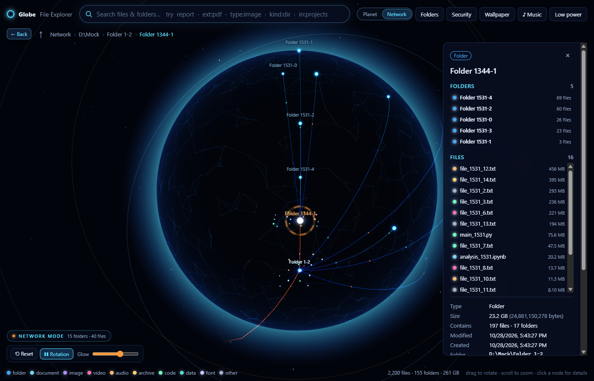
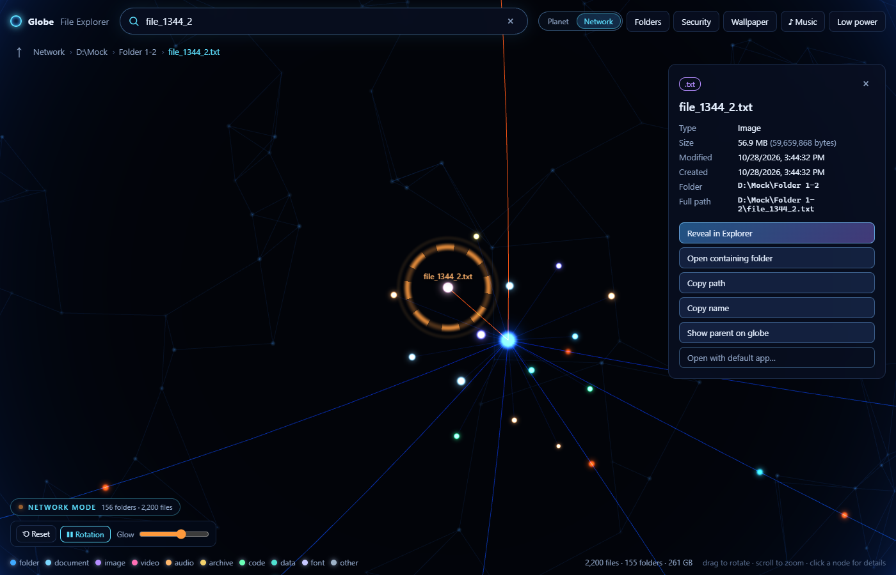
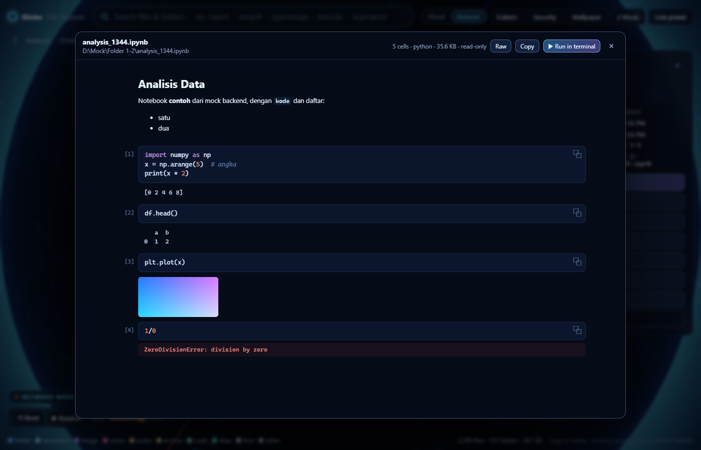
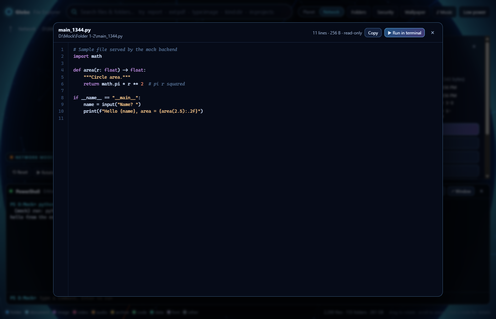

# Globe File Explorer

**Explore your files as a living 3D globe, right on your Windows desktop.**

Globe File Explorer turns the folders you choose into an interactive globe. Folders become glowing hubs, files orbit around them, and every connection is a real parent → child relation from your disk. You can search, read code and notebooks, open a terminal in any folder, keep the whole thing running as an animated wallpaper, and let it pulse to whatever music is playing.




<table>
  <tr>
    <td></td>
    <td></td>
    <td></td>
  </tr>
  <tr>
    <td align="center"><sub>Search → animated fly-to</sub></td>
    <td align="center"><sub>Jupyter notebook viewer</sub></td>
    <td align="center"><sub>Code viewer</sub></td>
  </tr>
</table>

<sub>Screenshots use the built-in sample data (see <a href="#development">Development</a>), not a real disk.</sub>

---

## Highlights

- **Two 3D views of the same index**
  - **Network Mode:** a glowing network. Folders are hubs, files cluster around them, and light pulses travel along the folder links. Folders open one by one like a tree in Explorer.
  - **Planet Mode:** every scanned folder is a planet. Sub-folders are regions whose area is proportional to their size, like WizTree on a sphere. Extra folders orbit the first one as moons.
- **Fast, read-only indexing.** A background, cancellable scanner records names, sizes and dates into SQLite and never reads file contents. It indexed about 11k files in 0.4 s on the development laptop.
- **Search with animated navigation.** Search supports `ext:pdf`, `type:image`, `kind:dir` and `in:projects` filters. Picking a result flies the camera there and lights the path from the root.
- **Live desktop wallpaper.** The globe runs behind or just above your desktop icons, starts at sign-in, keeps the taskbar visible, and pauses itself while a full-screen app covers it.
- **Music-reactive visuals.** The globe reacts to anything playing on the PC (Spotify, YouTube, games…) through WASAPI loopback and a real-time FFT, and a chip shows the current track.
- **A small developer workbench**
  - read-only code viewer with syntax colouring
  - Jupyter `.ipynb` viewer with plots and outputs
  - docked PowerShell / CMD terminal opened in any folder, with one-click "run this file"
- **Security first.** Only folders you pick are scanned, sensitive locations are excluded, dangerous file types are hidden, and nothing ever runs without an explicit opt-in and confirmation (see [Security model](#security-model)).

## Tech stack

| Layer | Technology |
|---|---|
| Desktop shell | [Tauri 2](https://tauri.app) (Rust backend, WebView2 frontend), tray, global hotkey, autostart, single instance |
| Backend | Rust: `rusqlite` (SQLite, WAL), `windows` / `windows-sys` (Win32 desktop layer, media session), `cpal` (WASAPI loopback), `rustfft` |
| Frontend | React 19, TypeScript, Vite, zustand |
| 3D | three.js through React Three Fiber, with custom GLSL shaders for nodes, links, particles, atmosphere and stars |
| Tests | `cargo test` (scanner, security policy, actions, terminal protocol), Vitest (layout, network graph, planets) |

## Getting started

### Prerequisites

- Windows 10 or 11 (WebView2 is preinstalled on Windows 11)
- [Node.js](https://nodejs.org) 20+
- [Rust](https://rustup.rs) stable (MSVC toolchain)
- Visual Studio Build Tools with the **Desktop development with C++** workload

### Run

```powershell
git clone <this-repo-url>
cd folder_globe
npm install
npm run tauri dev
```

The first run compiles the Rust backend and takes a few minutes. Later runs start in seconds.

### Build an installer

```powershell
npm run tauri build   # NSIS installer in src-tauri/target/release/bundle/nsis
```

### Tests

```powershell
npm test                     # frontend (Vitest)
cd src-tauri; cargo test     # backend
```

## Using it

| Action | How |
|---|---|
| Add a folder to map | **Folders → Add folder…** (the scan runs in the background and can be cancelled) |
| Switch view | **Planet / Network** toggle in the top bar |
| Rotate / zoom | Drag / mouse wheel |
| Open a folder, select a file | Click its node, its name on the globe, or its row in the details panel |
| Go back | **← Back** button, mouse back button, `Alt+←` or `Backspace` |
| Search | `Ctrl+F` or `/`, for example `report`, `ext:pdf`, `type:image`, `kind:dir`, `in:projects` |
| Read code / a notebook | Select a file → **</> View code** |
| Terminal in a folder | Select a folder → **›_ Terminal here** (PowerShell) or **CMD** |
| Run a script | Select a `.py` / `.js` / `.ps1` / … file → **▶ Run in terminal** (the command is typed in; you press Enter) |
| Wallpaper | **Wallpaper** panel. Use `Ctrl+Alt+G` to bring the globe to the front and click around |
| Music sync | **♪ Music** → *Sync visuals to music* |

The details panel also offers **Reveal in Explorer**, **Open folder**, **Copy path / name** and **Open with default app…**. Opening a file always asks first.

## Security model

The app is built to be safe to point at a real disk:

- **Allowlist scanning.** Nothing is scanned until you add a folder. Drive roots and the whole user profile need an extra confirmation.
- **Protected locations are never scanned.** These include Windows, Program Files, ProgramData, AppData (including browser profiles), the Recycle Bin, `.ssh`, `.gnupg`, `.aws` and similar.
- **Sensitive files are never indexed.** These include private keys and certificates, password vaults, `.env` files, git credentials and protected OS files. You can add your own exclusions.
- **Read-only.** The scanner only reads directory metadata. A test snapshots a folder before and after a scan to prove nothing changes. The app never deletes, moves, renames or uploads anything.
- **Links are not followed.** Symlinks and junctions are recorded as links and never followed.
- **Dangerous types are hidden.** Executables, scripts, installers and shortcuts are hidden by default. Running one needs all three of these:
  1. the category is made visible;
  2. **Allow launching programs** is turned on;
  3. a confirmation for each launch.

  A file whose content looks like a program despite a harmless extension is always refused.
- **Opt-in for contents and terminal.** The code viewer and the terminal are off by default and ask before being turned on. The terminal never runs as administrator, and nothing runs until you press Enter. Notebook HTML is never rendered (it could carry scripts).
- **Least privilege.** The webview has no filesystem, shell or opener plugins. Every action is addressed by an index **entry id**, never by a path coming from the UI. Launches, terminal sessions and commands are written to `launch-log.tsv`.
- **Local only.** The index and settings live in `%APPDATA%\com.globefileexplorer.app\`, and nothing leaves the machine. Music sync only measures the speaker output in memory and never uses the microphone.

## How it works

### Equal-area spherical treemap (Planet Mode)

The map works in **(longitude, sin latitude)** coordinates, the Lambert equal-area projection, where a rectangle's area equals its area on the sphere. A squarified treemap in that space gives each folder a region whose globe area is proportional to its real size.

Children are laid out inside their parent's region in a deterministic order, so search can rebuild exactly where any item lives. Large folders are paged: the 64 largest items are shown plus a "+N more" region.

Geometry is built relative to each region's own origin, which keeps folders 10+ levels deep sharp despite float32 GPU buffers.

### Network Mode

The same treemap splits the whole sphere between folders. Each folder sits in a "home" tile inside its region, with its files scattered around it in a low-discrepancy pattern.

Layout weights come from the index, not from what happens to be loaded, so opening a folder never moves anything else.

Nodes, links and particles are **one draw call each**, animated entirely in shaders. Opening and closing folders only rewrites a per-node "appear time" attribute, which makes children fade in one by one; no geometry is rebuilt. Picking is done in screen space, and name labels are placed per frame with overlap avoidance.

### Desktop wallpaper (Win32)

- **Behind the icons.** The window is re-parented into the desktop's `WorkerW` layer (the `Progman` `0x052C` technique). Both the classic layout and the Windows 11 24H2 layout are supported.
- **Interactive style.** A borderless window is pinned just above the icons through a `WM_WINDOWPOSCHANGING` subclass. It is sized to the monitor's work area, so the taskbar stays visible.
- **Watchdog.** It re-attaches after Explorer restarts and pauses rendering while a full-screen app covers the desktop.

### Music sync

The backend captures the default output device in **WASAPI loopback** and runs a **2048-point FFT** about 30 times a second. The result is split into 32 log-spaced bands with per-band auto-gain and bass-onset beat detection, then streamed to the UI as events.

The current track comes from the Windows media session (SMTC).

### Terminal

The terminal is a PowerShell or CMD process with piped I/O and no console window. A prompt marker tells the UI when a command has finished and which folder it is now in.

PowerShell lines containing non-ASCII text are sent base64-encoded and dot-sourced, which keeps variables and the current directory. CMD uses the marker as its own `PROMPT`, so a program waiting for input never receives extra text.

## Project structure

```
src-tauri/src/
  scanner.rs     read-only metadata scanner (background, cancellable, single transaction)
  db.rs          SQLite index: roots, entries, paging, ranking, search, locate
  security.rs    scan policy, exclusions, sensitive patterns, file categories (unit-tested)
  actions.rs     reveal / open / read-text, always by entry id
  terminal.rs    PowerShell / CMD sessions with streamed output
  audio.rs       WASAPI loopback, FFT, beat detection, now-playing
  wallpaper.rs   Win32 desktop-layer integration
  desktop.rs     window / wallpaper / overlay modes, tray, hotkey, autostart, watchdog
  lib.rs         Tauri commands and app setup
src/
  globe/         Planet Mode: layout, model, geometry, camera, planets, music state
  globe/network/ Network Mode: graph and layout, GPU buffers, scene, camera, labels
  components/    search, details panel, code / notebook viewer, terminal, settings panels
  state/store.ts zustand store: navigation, selection, search, modes
  dev/           mock backend for browser-only UI development
docs/screenshots/
```

## Development

The UI can be previewed in an ordinary browser, without Rust or Windows APIs, by using a generated sample tree:

```powershell
npm run dev
# open http://localhost:1420/?mock&view=network
```

The mock backend (`src/dev/mockBackend.ts`) only loads in development with `?mock`, and it is not part of production builds.

Other helpers:

```powershell
cd src-tauri
cargo run --example index_folder -- "<index.sqlite3>" "D:\Some\Folder"   # index without the UI
cargo run --example audio_probe                                         # check loopback capture
```

## Roadmap and known limitations

- [ ] Incremental rescans (a rescan currently rebuilds the folder's index; it is fast but not incremental)
- [ ] FTS5 trigram search (search is currently `LIKE` over lower-cased names)
- [ ] Multi-monitor wallpaper (currently the primary monitor only)
- [ ] A real pseudo-console for the terminal (Ctrl+C, full-screen console apps; for now use **Stop** or **↗ Window**)
- [ ] Category filters and disk-usage statistics
